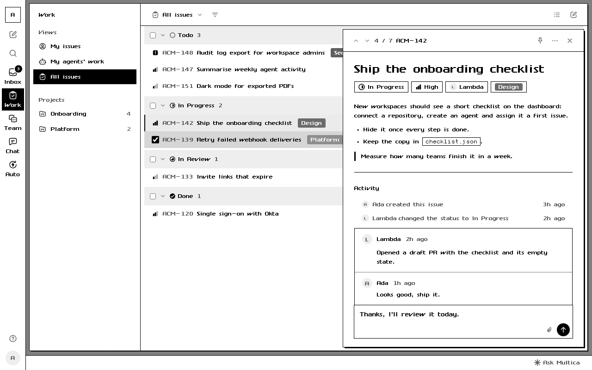
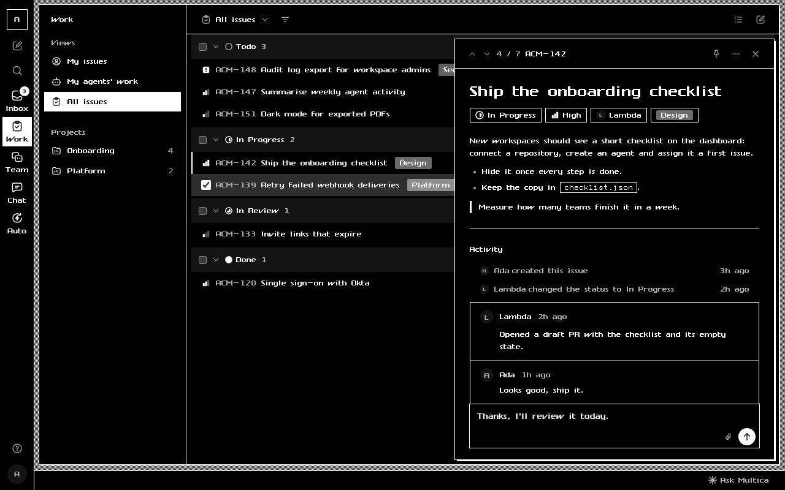

# Lisa for Multica

The Apple Lisa Office System (1983) as a [Multica](https://multica.ai) theme. The Lisa was the first personal computer from a PC maker to ship with a graphical interface, and the Macintosh grew out of it ([CHM: The Lisa, Apple's most influential failure](https://computerhistory.org/blog/the-lisa-apples-most-influential-failure/)).

| Light | Dark |
| --- | --- |
|  |  |

The Lisa had a one-bit screen, so the theme is black and white. Grey shows up only as a dither pattern on the desktop behind the page. Selected items are drawn in inverse video. Windows, menus and dialogs are square, with a 1px black frame and a hard drop shadow, and dialogs get the double rule of a Lisa alert box. Buttons are QuickDraw round rects. The interface uses Twiggy, a recreation of the Lisa's system font, and code uses the LisaTerminal font. Dark mode is the same screen in inverse video: white on black.

Install it from **Settings → Appearance → Manage → Import theme** in Multica, using `theme.zip` from the [latest release](../../releases/latest).

## Options

- **Document font**: the font for issue descriptions, comments and chat. Choose the Lisa system font (default), Modern (Helvetica) or Classic (Times). Modern and Classic are the names of LisaWrite's document fonts.
- **Dithered desktop**: on by default. The 50% one-bit pattern around the page. Turn it off for flat grey.
- **Colour status and labels**: off by default, so status icons, priorities and labels are black and white (labels in grey). Turn it on to keep their colours, darkened or lightened so they stay readable.

The Lisa fonts are bitmaps on a 13px grid. To keep them sharp, the theme sets interface text to 13px and headings to 26px or 39px. Twiggy has one weight, so bold text is not thickened.

## Develop

From a checkout of [multica-ai/multica](https://github.com/multica-ai/multica):

```bash
pnpm theme:check ../multica-lisa                        # validator and WCAG contrast checks
pnpm theme:preview ../multica-lisa --out screenshots    # light.png and dark.png
```

To release, bump `version` in `manifest.json`, tag the commit with the same version (`v1.0.1`), and push the tag. The release workflow attaches `theme.zip`.

## License

The theme is MIT licensed.

The fonts in `fonts/` are by Kreative Korporation ([Retro Computing Fonts](https://www.kreativekorp.com/software/fonts/retro/)): `TwiggyRaw.ttf` recreates the Lisa's SYSTEXT system font, and `LisaTerminalPaperRaw.ttf` recreates LisaTerminal's TILE*VT font. They ship unmodified under the Kreative Software Relay Fonts Free Use License (`fonts/LICENSE-FONT.txt`), which allows free redistribution and forbids selling or modifying them.

Apple and Lisa are trademarks of Apple Inc. This theme is not affiliated with or endorsed by Apple.
